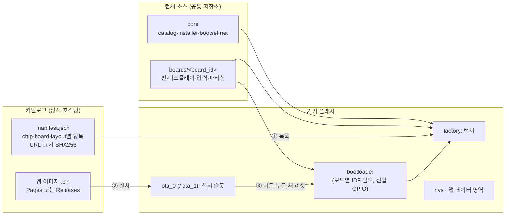

# ESP32 펌웨어 선택형 OTA 런처 구현 계획

2026-11-22 (다중 칩·보드 대응으로 개정)

## 개요

factory 파티션에 '런처' 펌웨어를 고정해 두고, 런처가 웹의 펌웨어 목록을 받아 기기에서 고른 펌웨어를 OTA 파티션에 설치하는 구조입니다. 어떤 펌웨어를 올려도 버튼 하나로 런처로 돌아올 수 있습니다.

이 런처는 특정 제품 전용이 아니라 **여러 ESP32 계열 칩과 여러 보드에서 쓰는 공통 런처**로 설계합니다. 첫 대상 보드는 DeskStream(ESP32-C3)이고, 처음부터 ESP32-S3·ESP32-C6 보드를 추가할 수 있는 구조로 만듭니다.

**목표**

- 앱·PC 없이 기기만으로 펌웨어 목록 조회, 선택, 설치, 전환
- 설치한 펌웨어가 OTA 기능을 갖고 있지 않아도 런처로 복귀 가능
- 다운로드 실패나 부팅 실패 시 기기가 벽돌이 되지 않음
- **칩·보드가 달라도 런처 코어는 그대로 두고, 보드 정의 파일만 추가해 지원**
- 설치되는 앱은 프레임워크 제약 없음(Arduino, ESP-IDF 모두 가능). 조건은 "보드의 파티션 테이블로 빌드할 것" 하나

**지원 범위**

| 칩 | 1차 지원 | 비고 |
| --- | --- | --- |
| ESP32-C3 | 예 (DeskStream) | RISC-V 단일 코어, Wi-Fi 4, 보통 4MB 플래시 |
| ESP32-S3 | 예 | 듀얼 코어, PSRAM 보드 많음, 8/16MB 플래시 흔함 |
| ESP32-C6 | 예 | Wi-Fi 6(2.4GHz), 4/8MB 플래시 |
| ESP32 (클래식) | 2차 | 구조상 가능, 검증은 나중 |
| ESP32-H2 등 Wi-Fi 없는 칩 | 제외 | 네트워크 설치 불가 |

**전체 흐름**

1. 전원 인가 → 부트로더가 런처 진입 버튼 확인(누른 채 리셋이면 factory 부팅)
2. 런처: 진입 조건이 없고 설치된 앱이 있으면 그 앱으로 부팅
3. Wi-Fi 연결(저장된 정보가 없으면 SoftAP 포털로 설정)
4. 보드에 등록된 카탈로그 URL에서 `manifest.json` 다운로드 → **칩·보드·파티션 레이아웃이 일치하는 항목만** 목록 표시
5. 사용자가 선택 → HTTPS로 앱 이미지를 OTA 파티션에 스트리밍 기록
6. SHA256·이미지 헤더 검증 → 부트 파티션 변경 → 재부팅

## 설계 원칙

1. **코어와 보드를 분리**: 다운로드·검증·상태 머신·카탈로그는 칩·보드와 무관한 코어에 두고, 핀·디스플레이·입력·파티션·기본 카탈로그 URL은 보드 정의(Board Profile)에 둡니다.
2. **호환성 키는 세 개**: `chip`(IDF target), `board`(보드 ID), `layout`(파티션 레이아웃 ID). 셋이 모두 맞는 앱만 설치합니다. 같은 칩이라도 파티션 테이블이 다르면 설치하지 않습니다.
3. **런처 번들은 보드별로 한 벌**: 부트로더 + 파티션 테이블 + otadata 초기값 + 런처 앱을 보드마다 빌드해 한 번만 USB로 설치합니다. 이후 앱은 OTA 슬롯에만 들어갑니다.
4. **런처는 작게**: 기능은 목록·설치·Wi-Fi 설정으로 한정합니다. 런처 교체는 위험하므로 자주 바꿀 일이 없게 만듭니다.
5. **최소 하드웨어 요구**: 버튼 2개(하나는 부트로더 진입용 겸용 가능) + 문자 3줄 이상 표시 가능한 화면. 화면이 없는 보드(LED + 웹 포털 UI)는 1차 완료 후 별도 단계(M8)에서 지원하며, 1차에서는 UI 모델과 포털을 그때 확장할 수 있게만 만듭니다.

## 시스템 아키텍처



## 저장소와 빌드 구조

런처는 **ESP-IDF(v6.1, 저장소의 `IDF_VERSION`에 고정)** 로 작성합니다. 이유는 다음과 같습니다.

- 부트로더 설정(`CONFIG_BOOTLOADER_FACTORY_RESET` 등)은 Arduino의 미리 빌드된 부트로더에서 바꿀 수 없어 어차피 IDF 빌드가 필요합니다.
- `idf.py set-target esp32c3|esp32s3|esp32c6`만으로 칩을 바꿀 수 있고, 앱 크기 관리가 Arduino보다 쉽습니다.
- 설치되는 앱은 Arduino로 만들어도 됩니다(DeskStream 프로젝트들이 그 예).

런처는 독립 저장소 **`esp-launcher`** 에 둡니다. DeskStream 저장소는 이 런처의 보드 정의 하나와 카탈로그를 제공하는 사용자 쪽이 됩니다.

```
esp-launcher/
  main/                    # 상태 머신, 진입점
  components/
    core_catalog/          # manifest 다운로드·파싱·필터·캐시
    core_installer/        # OTA 기록, SHA256, 헤더 검사, 부트 전환
    core_bootsel/          # 런처 진입 판단, 설치본 부팅
    core_net/              # Wi-Fi STA, SoftAP 캡티브 포털
    core_settings/         # NVS(launcher 네임스페이스)
    core_ui/               # 화면 모델(목록·진행률·오류), 폰트
    hal_display/           # 디스플레이 백엔드 인터페이스 + 드라이버들
    hal_input/             # 입력 이벤트 인터페이스 + 드라이버들
  boards/
    deskstream_c3/
      board.c              # board_init(), 핀, 디스플레이·입력 드라이버 선택
      board.h
      partitions.csv
      sdkconfig.defaults   # 타깃, 플래시 크기, 부트로더 진입 GPIO 등
      board.json           # 메타데이터(아래 참조)
    <다른 보드>/
  tools/
    mkbundle.py            # 보드별 런처 번들 생성(bootloader+파티션+otadata+런처)
    mkentry.py             # 앱 .bin → manifest 항목(크기, sha256, 헤더 검사)
```

빌드는 보드 이름 하나로 정해지도록 합니다.

```bash
tools/build.sh deskstream_c3    # = idf.py -B ~/.cache/esp-launcher/build/deskstream_c3 -DBOARD=deskstream_c3 build
```

`CMakeLists.txt`가 `BOARD`로 `board.json`의 `chip`을 타깃으로 정하고(보드 `sdkconfig.defaults`의 `CONFIG_IDF_TARGET`과 다르면 중단), 공통 `sdkconfig.defaults` 위에 보드 `sdkconfig.defaults`를 덮어씁니다. 빌드 폴더는 저장소 밖(`~/.cache/esp-launcher/build/<board>`)에 둡니다. 저장소 경로에 한글·공백이 있으면 GCC가 빌드 폴더의 specs 파일을 읽지 못하기 때문입니다. CI는 보드 목록을 행렬로 돌려 보드별 번들을 만듭니다.

**board.json 예시**

```json
{
  "id": "deskstream_c3",
  "name": "DeskStream",
  "chip": "esp32c3",
  "flash_size": "4MB",
  "layout": "ds4m-v1",
  "catalog_url": "https://<user>.github.io/DeskStream/firmware/manifest.launcher.json",
  "entry_gpio": 1,
  "entry_hold_ms": 2000,
  "display": "ssd1306_x4",
  "input": "buttons4"
}
```

## 보드 추상화(HAL)

코어는 아래 인터페이스만 사용합니다. 새 보드는 이 함수들을 구현한 드라이버를 고르거나 추가하면 됩니다.

**디스플레이**

```c
typedef struct {
    uint16_t width, height;
    uint8_t  tiles_x;        // 가로로 이어 붙인 패널 수 (한 장이면 1)
    bool     color;          // false면 1bpp 모노
} disp_info_t;

typedef struct {             // 드라이버가 채워 disp_register()로 등록
    disp_info_t info;
    void (*fill_rect)(int x, int y, int w, int h, bool on);
    void (*draw_bitmap)(int x, int y, int w, int h, int stride, const uint8_t *bits, bool on);
    void (*flush)(void);     // 바뀐 영역만 전송
    void (*set_brightness)(uint8_t level);
} disp_driver_t;
```

- 화면 HAL은 픽셀 그리기만 맡고, 글자(글꼴·줄바꿈)는 `core_ui`가 그립니다. 드라이버가 없는 보드에서는 그리기가 아무 일도 하지 않습니다.
- 드라이버: `disp_ssd1306_tiles`(SSD1306 128×64를 1~4장 가로로 이어 씀, DeskStream 512×64), I2C 버스는 칩 컨트롤러(HW)와 GPIO 비트뱅(SW) 둘 다 지원. S3용 컬러 LCD 드라이버는 S3 보드를 정한 뒤 추가합니다(`esp_lcd`를 감쌈).
- 글꼴: 갈무리7(8px, OFL). `tools/mkfont.py`가 DeskStream에 있는 U8g2 글꼴에서 소스 문자열에 쓰인 글자만 뽑습니다(ASCII 포함 약 1KB). 화면 문구는 영어이고, 한글은 manifest 이름을 표시할 때(M4) 범위를 다시 정합니다.

**입력**

```c
typedef enum { IN_NONE, IN_PREV, IN_NEXT, IN_SELECT, IN_BACK, IN_KEY_BASE = 16 } in_event_t;
#define IN_KEY(n) ((in_event_t)(IN_KEY_BASE + (n)))   // 화면 패널 n 아래 키

in_event_t input_poll(uint32_t timeout_ms);
void       input_set_softkeys(uint8_t count);         // 패널 아래 키 수 (보드가 알림)
```

- 드라이버: `input_gpio_buttons`(디바운스, 길게 누르기 선택, 시작할 때 눌려 있던 버튼은 한 번 뗄 때까지 무시)
- 버튼 2개 보드: 짧게 = NEXT, 길게 = SELECT
- 패널마다 바로 아래 버튼이 있는 보드(DeskStream): 버튼이 `IN_KEY(n)`을 내고 아래 "패널 키 방식" UI를 씁니다.
- 로터리 엔코더·터치는 같은 이벤트로 바꿔 넣는 드라이버로 2차 지원

**화면 UI (`core_ui`)**

- 패널 키 방식(패널 수 ≥ 3이고 패널마다 아래 키가 있는 보드): 버튼 위 패널 아래쪽에 그 버튼의 기능을 반전 막대로 표시하고, 버튼은 그 기능만 합니다.
  - 고를 항목이 패널 수 이하면 패널마다 항목 하나, 아래 버튼으로 바로 진입 (DeskStream 메인 메뉴: Run · Firmware · Wi-Fi · Info)
  - 항목이 많으면 첫 패널에 목록, 나머지 패널에 고른 항목 설명, 오른쪽 세 키가 Next · Select · Back (DeskStream: BTN2·BTN3·BTN4)
  - 메시지·오류: 첫 패널 제목, 나머지 패널 본문, 마지막 키 Back
- 줄 목록 방식(그 밖의 보드): 맨 윗줄 제목, 아래 줄 목록, 이동 이벤트로 조작
- 글자는 패널 경계를 넘지 않게 패널 안에서 줄바꿈하고, 넘치면 다음 패널로 이어 씁니다.

**보드 초기화**

`boards/<id>/board/board.c`의 `board_init()`에서 전원 제어 핀, 백라이트, I2C/SPI 버스를 켜고 화면·입력 드라이버를 등록합니다(이 폴더가 `board` 컴포넌트로 빌드에 들어감). 배터리 보드는 `board_battery_percent()`를 구현하면 설치 전 잔량 검사가 켜집니다(구현하지 않으면 검사 생략).

## 칩별 고려 사항

| 항목 | ESP32-C3 | ESP32-S3 | ESP32-C6 |
| --- | --- | --- | --- |
| 스트래핑 핀(진입 버튼으로 쓰면 안 됨) | GPIO 2, 8, 9 | GPIO 0, 3, 45, 46 | GPIO 8, 9, 15 |
| BOOT 버튼 위치(일반적) | GPIO 9 | GPIO 0 | GPIO 9 |
| 흔한 플래시 | 4MB | 8/16MB | 4/8MB |
| PSRAM | 없음 | 보드에 따라 있음 | 없음 |
| USB | USB-Serial/JTAG | USB-Serial/JTAG + OTG | USB-Serial/JTAG |
| 비고 | RAM 400KB, TLS 버퍼 여유 확인 | 화면 드라이버 선택 폭 넓음 | Wi-Fi 6, 802.15.4 미사용 |

- **런처 진입 GPIO는 스트래핑 핀이 아닌 핀**으로 보드마다 지정합니다. BOOT 버튼을 누른 채 리셋하면 다운로드 모드로 들어가므로 진입 버튼으로 쓸 수 없습니다. 런처 안에서 일반 입력으로 쓰는 것은 괜찮습니다.
- 진입 유지 시간은 모든 보드 기본 2초(`CONFIG_BOOTLOADER_HOLD_TIME_GPIO=2`)입니다.
- **플래시 모드(QIO/DIO)는 그 보드의 앱이 전제한 모드에 맞춥니다.** 부트로더가 정한 플래시 모드를 앱이 이어받기 때문입니다. M4 후 실기 조사(2026-11-22)에서 확인했습니다.
    - 런처 부트로더가 DIO였을 때 QIO 전제로 빌드된 Arduino 앱(DeskStream)의 플래시 읽기가 0xFF가 되었습니다. 그 결과 저장한 Wi-Fi·설정이 사라지고, NVS namespace 중복, LittleFS 손상이 생겼습니다.
    - 부트로더를 QIO로 바꾸자 IDF 6.1·5.5.5 모두 정상이 됐습니다. IDF 버전은 원인이 아니었습니다.
    - Arduino ESP32 코어는 `boards.txt`의 `build.boot`(MakerGO C3 SuperMini = `qio`)로 실제 모드를 정하고, 이미지 헤더에는 `build.flash_mode`(`dio`)를 적습니다. 그래서 헤더 값만 보고 판단하면 틀립니다.
- DeskStream: 진입 버튼은 **BTN1(GPIO1)** 입니다. BTN4(GPIO9)는 BOOT 핀이라 쓰지 않습니다.
- 앱 이미지 헤더의 `chip_id`를 런처가 확인해 다른 칩용 이미지를 거부합니다(manifest가 틀려도 막힘).
- 스트래핑 핀 목록과 메모리 수치는 대상 칩의 데이터시트·TRM으로 M0에서 다시 확인합니다.

## 파티션 레이아웃

레이아웃은 **보드별로 하나**이고 ID를 붙여 관리합니다(`ds4m-v1` 등). 파티션 테이블은 OTA로 바꾸지 않으므로, 레이아웃을 바꾸면 ID를 올리고 런처 번들을 USB로 다시 설치합니다. 그 보드용 앱은 모두 그 레이아웃으로 빌드해야 합니다.

**플래시 용량별 기본형**

| 플래시 | factory(런처) | OTA 슬롯 | 앱 최대 크기 | 데이터 영역 |
| --- | --- | --- | --- | --- |
| 4MB | 1MB | ota_0 1개 | 약 1.5MB(데이터 영역 크기에 따라 조정) | 1MB 안팎 |
| 8MB | 1MB | ota_0 1개 | 6MB | 약 0.9MB |
| 16MB | 1MB | ota_0 1개 | 12MB 안팎 | 2MB 이상 |

- 모든 플래시 용량에서 설치 슬롯은 ota_0 하나입니다(M3 결정). 설치에 실패해도 factory 런처가 남아 있으므로 슬롯 2개가 꼭 필요하지 않고, 런처 코드가 모든 보드에서 같습니다.
- 런처 크기는 Wi-Fi + TLS + 디스플레이 + 한글 서브셋 폰트 기준 1MB 이내를 목표로 하고, 보드마다 `idf.py size` 결과에서 20% 이상 여유를 둡니다.
- 앱 데이터 영역(SPIFFS/LittleFS)의 오프셋과 크기는 레이아웃의 일부입니다. 앱을 바꿔도 같은 위치에 있어야 앱 데이터(글꼴 등)가 유지됩니다.
- `nvs`는 앱과 공유합니다. 런처 설정은 `launcher` 네임스페이스에만 씁니다.

**DeskStream 레이아웃(`ds4m-v1`) 안**

기존 DeskStream 앱의 `spiffs`(0x290000, 1.375MB, 시계 글꼴 저장)와 `nvs`(0x9000, Wi-Fi 설정) 위치를 그대로 유지해 기존 데이터를 살립니다.

```csv
# Name,   Type, SubType,  Offset,   Size
nvs,      data, nvs,      0x9000,   0x5000
otadata,  data, ota,      0xe000,   0x2000
factory,  app,  factory,  0x10000,  0x100000
ota_0,    app,  ota_0,    0x110000, 0x180000
spiffs,   data, spiffs,   0x290000, 0x160000
coredump, data, coredump, 0x3f0000, 0x10000
```

- 현재 가장 큰 앱 DS_DECK(1,420,240B)가 ota_0(1,572,864B)에 약 10% 여유를 두고 들어갑니다.
- 런처가 1MB를 넘으면 `spiffs`를 줄이는 대신 레이아웃 ID를 올려야 하므로, M1에서 런처 크기를 먼저 확인합니다.
- M1 측정(2026-11-22, IDF 6.1, C3, `-Os`): IDF `simple_ota_example`(Wi-Fi + TLS + HTTPS OTA)이 915KB, 로그 WARN·WPA3 끄기 등으로 줄이면 805KB. 1MB 중 약 200KB가 화면·포털·폰트·JSON 몫으로 남아 들어갈 수 있지만, 20% 여유 목표(838KB 이하)는 맞추기 어렵습니다. M3에서 실제 런처로 다시 재고, 넘치면 그때 레이아웃을 정합니다(`ds4m-v1`을 배포하기 전이므로 바꿔도 이전 부담 없음).
- M3 측정(2026-11-22): 실제 런처(화면·포털·HTTPS 설치·개발용 콘솔)가 처음 1,056,800B로 1MB를 넘었고, Wi-Fi Enterprise·OWE·SAE-PK·SoftAP SAE 끄기와 assert 메시지 제거로 **987,296B(여유 5.9%)**. 20% 목표에 못 미쳐 "더 줄이기"로 결정(레이아웃 `ds4m-v1` 유지).
    - 결과: 기본 로그 WARN·`esp_err_to_name` 표 빼기(−19KB), 개발용 콘솔을 시험 빌드(`-DLAUNCHER_DEV=ON`)로 분리(−30KB), TLS 클라이언트 전용·쓰지 않는 곡선/모드/기능 빼기·인증서 묶음 CMN(−65KB), IPv6 끄기(−25KB) → **C3 845,552B(여유 19.4%)**, S3 782,672B(25.4%). Pages·GitHub raw 설치를 실기로 다시 확인
    - 더 줄이려면 기능을 포기해야 합니다(WPA3 끄기 등). M4·M5에서 크기가 늘면 그때 다시 정합니다

## 카탈로그(manifest)

정적 호스팅만으로 충분합니다. 카탈로그는 보드 쪽 저장소(예: DeskStream의 GitHub Pages)가 제공하고, 런처는 보드 정의에 적힌 기본 URL과 사용자가 포털에서 추가한 URL(최대 3개)을 읽습니다.

**manifest.json 스키마 (런처용)**

```json
{
  "schema": 1,
  "updated": "2026-11-22",
  "firmwares": [
    {
      "id": "Hangeul_Clock",
      "name": "한글 시계",
      "nameEn": "Hangeul Clock",
      "version": "2.11.1",
      "chip": "esp32c3",
      "board": "deskstream_c3",
      "layout": "ds4m-v1",
      "url": "https://<user>.github.io/DeskStream/firmware/Hangeul_Clock/Hangeul_Clock.ino.bin",
      "size": 1221744,
      "sha256": "<64자리 hex>",
      "min_launcher": "1.0.0",
      "desc": "고화질 폰트 한글 시계"
    }
  ]
}
```

- `chip`·`board`·`layout`이 모두 맞는 항목만 표시합니다. `board`에 `"*"`를 허용해 같은 칩·레이아웃을 쓰는 여러 보드에 공통 앱을 줄 수 있게 합니다(예: I2C 스캐너).
- `size`가 OTA 슬롯보다 크면 목록에서 비활성화합니다.
- `min_launcher`보다 런처가 낮으면 "런처 업데이트 필요"로 표시하고 설치하지 않습니다.
- `url`은 GitHub Pages(리다이렉트 없음)와 GitHub Releases(302 리다이렉트) 모두 지원합니다.
- 한 카탈로그에 여러 보드 항목을 담아도 되고, 보드별로 파일을 나눠도 됩니다. 항목이 많아지면 `manifest-<board>.json`으로 나눕니다.

**배포 도구**

- `tools/mkentry.py`: 앱 `.bin`을 받아 이미지 헤더(`chip_id`)와 크기를 검사하고 manifest 항목을 출력합니다. 각 보드 저장소의 CI나 빌드 스크립트에서 부릅니다.
- DeskStream은 기존 `tools/collect-firmware.mjs`가 이미 `size`·`sha256`을 계산하므로, 웹 플래셔용 `manifest.json`과 별도로 런처용 `manifest.launcher.json`을 함께 만들도록 확장합니다.

## 런처 펌웨어 동작

**상태 머신**

1. `BOOT` — 진입 조건 확인. 조건이 없고 설치된 앱이 유효하면 그 앱으로 부팅
2. `WIFI_CONNECT` — 저장된 AP에 차례로 연결. 15초 안에 실패하면 `PROVISION`
3. `PROVISION` — SoftAP 포털로 SSID·비밀번호·카탈로그 URL 입력 후 `WIFI_CONNECT`
4. `FETCH_LIST` — 카탈로그 다운로드. 실패하면 캐시 목록을 보여주고 재시도
5. `BROWSE` — 목록, 상세(버전·크기·설명), 현재 설치본 표시
6. `CONFIRM` — "Hangeul Clock 2.11.1 설치?"
7. `DOWNLOAD` — 진행률 표시, 취소 가능
8. `VERIFY` — SHA256·헤더 확인. 불일치면 `ERROR`
9. `REBOOT` — 부트 파티션 설정 후 재부팅
10. `ERROR` — 원인 표시 후 `BROWSE`로 복귀

추가 메뉴: Wi-Fi 재설정, 설치본 바로 실행, 런처 정보(런처 버전, 보드 ID, 레이아웃 ID, 칩 ID, 슬롯 크기).

설치본 이름·버전은 런처가 설치할 때 manifest 값(`id`, `name`, `version`, `sha256`)을 `launcher` 네임스페이스에 기록해 두고 그것을 표시합니다. 앱 이미지의 `esp_app_desc_t`는 Arduino 앱이면 모두 `arduino-lib-builder`로 나와 구분할 수 없습니다(M1 실기 확인). 기록된 `sha256`이 슬롯 내용과 다르면(USB로 직접 올린 경우) "알 수 없는 앱"으로 표시합니다.

**런처 진입 판단(`BOOT` 단계)**

- 부트로더 GPIO 진입으로 factory가 부팅된 경우
- 앱이 `return_to_launcher()`로 요청한 경우(아래 참조)
- ota 슬롯이 비었거나 이미지가 유효하지 않은 경우

## 다운로드·설치·부팅 전환

`esp_https_ota`의 단계별 API로 진행률과 취소를 지원합니다. 부트 파티션은 SHA256 확인이 끝난 뒤에만 바꿉니다.

```c
esp_http_client_config_t http = {
    .url = fw->url,
    .crt_bundle_attach = esp_crt_bundle_attach,
    .max_redirection_count = 5,   // GitHub Releases 302 대응
    .buffer_size_tx = 2048,       // 긴 리다이렉트 URL 대응
    .keep_alive_enable = true,
};
esp_https_ota_config_t cfg = { .http_config = &http };
esp_https_ota_handle_t h;
if (esp_https_ota_begin(&cfg, &h) != ESP_OK) return ui_error("연결 실패");

esp_app_desc_t desc;
if (esp_https_ota_get_img_desc(h, &desc) != ESP_OK) { esp_https_ota_abort(h); return; }
// 이미지 헤더의 chip_id는 esp_https_ota가 대상 칩과 비교해 다르면 실패시킨다

while (esp_https_ota_perform(h) == ESP_ERR_HTTPS_OTA_IN_PROGRESS) {
    ui_progress(esp_https_ota_get_image_len_read(h), fw->size);
    if (ui_cancel_pressed()) { esp_https_ota_abort(h); return; }
}
if (!esp_https_ota_is_complete_data_received(h)) { esp_https_ota_abort(h); return; }

// finish는 성공 시 부트 파티션을 새 이미지로 바꾼다
if (esp_https_ota_finish(h) != ESP_OK) return ui_error("검증 실패");
if (!sha256_matches(fw)) {                 // esp_partition_get_sha256()으로 비교
    esp_ota_set_boot_partition(esp_partition_find_first(
        ESP_PARTITION_TYPE_APP, ESP_PARTITION_SUBTYPE_APP_FACTORY, NULL));
    return ui_error("SHA256 불일치");
}
esp_restart();
```

## 런처 복귀 방법

1. **부트로더 GPIO 진입(필수)**: 보드의 `sdkconfig.defaults`에 `CONFIG_BOOTLOADER_FACTORY_RESET=y`, `CONFIG_BOOTLOADER_NUM_PIN_FACTORY_RESET=<entry_gpio>`, `CONFIG_BOOTLOADER_HOLD_TIME_GPIO=2`, `CONFIG_BOOTLOADER_OTA_DATA_ERASE=y`를 지정합니다. `CONFIG_BOOTLOADER_DATA_FACTORY_RESET=""`로 비워 두어 NVS와 앱 데이터가 지워지지 않게 합니다. 앱이 무엇이든 동작하는 유일한 방법입니다.
    - IDF 6.1 부트로더 소스 확인 결과: 진입 조건이 맞으면 otadata가 고른 파티션으로 부팅하므로, `OTA_DATA_ERASE`로 otadata를 지워야 factory로 부팅합니다. 비운 지우기 목록은 어떤 데이터 파티션과도 일치하지 않아 안전합니다.
    - 그 결과 런처 진입 후에는 설치된 앱 선택이 풀립니다. 앱 이미지는 ota_0에 그대로 있으므로, 런처의 "설치본 바로 실행"이 ota_0을 다시 부트 파티션으로 지정합니다.
2. **소프트웨어 복귀(선택)**: 앱 쪽 공통 라이브러리에 `return_to_launcher()`를 넣습니다. factory 파티션을 부트 파티션으로 설정하고 재부팅합니다. IDF용 컴포넌트와 Arduino용 라이브러리를 함께 제공합니다(DeskStream은 DeskStreamCore에 추가).
3. **앱 롤백은 쓰지 않음(모든 보드)**: 롤백을 켜면 `esp_ota_mark_app_valid_cancel_rollback()`을 부르지 않는 앱이 다음 재부팅에서 되돌아가므로, 남이 만든 펌웨어도 설치할 수 있도록 끕니다(`CONFIG_BOOTLOADER_APP_ROLLBACK_ENABLE` 미설정). 부팅에 실패한 앱은 1번 버튼 진입으로 복구합니다.

## Wi-Fi 프로비저닝

- SoftAP + 캡티브 포털. AP 이름은 `<보드이름>-XXXX`(MAC 뒷자리). 화면이 충분하면 접속용 QR 코드(`WIFI:S:...;;`)도 표시
- DNS 서버가 모든 도메인을 `192.168.4.1`로 응답해 휴대폰이 설정 페이지를 자동으로 띄움
- AP 최대 3개, 카탈로그 URL 최대 3개를 `launcher` 네임스페이스에 저장
- 포털 페이지는 칩·보드와 무관한 코어에 둡니다
- BLE 프로비저닝(전용 앱 필요)과 WPA2-Enterprise는 1차 범위에서 제외
- **앱과 Wi-Fi 정보를 공유합니다.** 런처는 AP 목록(최대 3개)을 `launcher` 네임스페이스에 두고, 연결에 성공한 AP는 Wi-Fi 드라이버의 NVS 저장소(`WIFI_STORAGE_FLASH`)에도 씁니다. 그래서 저장된 AP로 연결하는 앱(Arduino `WiFi.begin()` 무인자, IDF 기본 설정)은 따로 설정하지 않아도 연결됩니다. DeskStreamCore의 `ds_wifi`가 이 방식입니다.
- NVS는 앱과 공유하므로 런처는 지우지 않습니다. 단, 아무도 쓸 수 없는 두 오류(`ESP_ERR_NVS_NO_FREE_PAGES`, `ESP_ERR_NVS_NEW_VERSION_FOUND`)일 때만 지우고 다시 만들며, 화면에 "Storage reset"을 알립니다(Arduino 앱도 같은 경우 지움). M3 실기에서 앱이 저장 중 리셋돼 이 상태가 실제로 생겼습니다.
- 반대로 앱 포털에서 바꾼 AP는 런처가 다음 부팅 때 드라이버 저장소에서 읽어 목록에 추가합니다.

## 런처 번들과 첫 설치

보드마다 아래 네 파일을 묶은 "런처 번들"을 만듭니다(`tools/mkbundle.py`).

| 오프셋 | 내용 |
| --- | --- |
| 칩별 부트로더 오프셋(C3·C6·S3는 0x0) | 진입 GPIO가 설정된 부트로더 |
| 0x8000 | 보드 레이아웃 파티션 테이블 |
| otadata 오프셋 | 지운 상태(→ factory 부팅) |
| factory 오프셋 | 런처 |

- 첫 설치는 웹 플래셔(esptool-js) 또는 `esptool.py`로 한 번만 합니다.
- 이후 USB로 앱을 직접 올릴 때도 **부트로더와 파티션 테이블은 쓰지 않고**, 앱을 ota_0 오프셋에 쓰고 otadata를 ota_0 선택값으로 써야 런처가 보존됩니다. 기존 웹 플래셔가 있는 보드(DeskStream)는 이 방식으로 바꿉니다.
- M1 확인(DeskStream 실기): 0x10000용으로 빌드된 Arduino 앱(`Hangeul_Clock`, `DS_DECK`) 이미지를 그대로 ota_0(0x110000)에 써도 IDF 6.1 부트로더로 정상 부팅합니다. otadata는 ota_0을 고르는 값(Arduino `boot_app0.bin`과 같은 seq=1)으로 쓰면 되고, `tools/flash-app.sh`가 IDF `otatool switch_ota_partition`으로 만듭니다.

## 보안과 무결성

| 수단 | 막는 것 | 단계 |
| --- | --- | --- |
| HTTPS + `esp_crt_bundle` | 중간자 변조, 가짜 서버 | 필수 |
| manifest의 SHA256 비교 | 전송 중 손상, 잘못된 파일 | 필수 |
| 이미지 헤더 검사(`chip_id`, 매직) + manifest의 chip·board·layout | 다른 칩·보드용 이미지 설치 | 필수 |
| 앱 롤백 | 부팅 불가 펌웨어 | 사용 안 함(버튼 진입으로 대신함) |
| 서명 검증(`CONFIG_SECURE_SIGNED_APPS_NO_SECURE_BOOT`) | 서버 탈취 시 악성 펌웨어 | 배포 시 |
| Secure Boot v2 + Flash Encryption | 물리적 접근, 펌웨어 추출 | 양산 시(eFuse 되돌릴 수 없음) |
| manifest 자체 서명(Ed25519) | 목록 조작 | 선택 |

- 사용자가 카탈로그 URL을 추가할 수 있으므로, 서명 검증을 켜지 않은 보드에서는 "알 수 없는 카탈로그" 경고를 표시합니다.
- 안티 롤백(보안 버전 eFuse)은 펌웨어를 자유롭게 바꾸는 목적과 충돌하므로 쓰지 않습니다.
- 다운로드 전 `size`와 슬롯 크기를 비교하고, 배터리 보드는 잔량 30% 이상일 때만 설치합니다.

## 단계별 일정

혼자 저녁·주말에 진행하는 기준 1차(M0~M7) 약 9~11주입니다. 각 단계는 완료 조건을 만족해야 다음으로 넘어갑니다. 처음부터 **C3(DeskStream)과 S3 보드 하나를 함께** 진행해 칩 의존 코드가 코어에 섞이지 않게 합니다.

1. **M0 준비 (1~2일)** — `esp-launcher` 저장소 생성, IDF 버전 고정, `boards/deskstream_c3` 정의 작성. 1차 S3 보드는 M1 시작 전까지, C6 보드는 M7 시작 전까지 정합니다
    - 완료 조건: `boards/deskstream_c3`의 `board.json`·`partitions.csv`·`sdkconfig.defaults` 확정
    - 진행 (2026-11-22): 저장소(`VibeCoding/esp-launcher`) 생성, IDF v6.1 고정, `deskstream_c3` 보드 정의 작성. 파티션 테이블은 `gen_esp32part.py`로 검증. 부트로더 설정의 실제 동작은 M1에서 보드로 확인
2. **M1 빌드 골격·부팅 (1~2주)** — `BOARD` 인자 빌드, 보드별 부트로더·파티션, 진입 버튼으로 factory 부팅, 테스트 앱을 ota_0에 USB로 올려 전환
    - 완료 조건: C3·S3 두 보드에서 어떤 앱에서도 버튼으로 런처 복귀, 런처 크기 1MB 이내 확인
    - S3 보드가 정해지지 않았다면 S3는 `esp32s3` 타깃 빌드 성공까지만 확인하고, 실제 보드 검증은 M2 안에 마칩니다
    - 진행 (2026-11-22): `BOARD` 인자 빌드(`tools/build.sh`), 런처 진입 판단·설치본 조회·실행(`core_bootsel`), 개발용 시리얼 콘솔(`info`/`run`/`restart`), 앱을 ota_0에 올리는 `tools/flash-app.sh` 작성. C3 빌드 성공(런처 185KB, 부트로더 22.7KB). DeskStream 실기 시험 통과: 런처 설치 후 factory 부팅, `Hangeul_Clock`·`DS_DECK`을 ota_0에 올려 부팅·전환, BTN1을 누른 채 리셋하고 2초 유지하면 런처 진입(otadata만 지우고 nvs·spiffs 보존, 진입 이유 "진입 버튼" 인식), 1초 안에 떼면 앱 부팅, 콘솔 `run`으로 앱 복귀. S3는 임시 보드 정의(`s3_generic_tmp`, 8MB, ota_0·ota_1 각 3MB)로 코어 코드 수정 없이 빌드 성공(런처 215KB, 부트로더 22.5KB). 실제 S3 보드 정의와 실기 검증은 M2 안에서 진행
    - 8MB 레이아웃은 M3에서 ota_0 하나(6MB)로 합쳤습니다
    - IDF 6.1 `otatool write_ota_partition`은 인자 이름 불일치로 실패해 `flash-app.sh`는 쓰기에 `parttool`을 씁니다
3. **M2 HAL·UI (1~2주)** — 디스플레이·입력 인터페이스, `ssd1306_x4`와 S3용 LCD 드라이버, 목록·진행률·오류 화면, 한글 서브셋 폰트
    - 완료 조건: 같은 코어 코드가 두 보드에서 같은 메뉴를 표시
    - 진행 (2026-11-22): 화면·입력 HAL, SSD1306 이어 쓰기 드라이버(HW·SW I2C), GPIO 버튼 드라이버, 패널 키 방식·줄 목록 방식 UI, 갈무리7 서브셋 글꼴 도구 작성. DeskStream 실기 확인: 메인 메뉴 패널 4장 ↔ 버튼 4개 대응, 견본 펌웨어 목록(Next·Select·Back), 진행률·오류·정보 화면. 화면 문구는 사용자 요청으로 영어. 런처 219KB. S3는 임시 보드로 빌드만 확인
    - 남은 일: 실제 S3 보드 정의, 컬러 LCD 드라이버, S3 실기에서 줄 목록 방식 확인
    - 사용 중 고친 문제: SW I2C 핀을 출력으로 바꾸는 순간 LOW가 나가 첫 패널이 초기화 응답을 못 함 → 핀을 먼저 HIGH로 두고 9클럭 + STOP으로 버스 정리
4. **M3 네트워크·설치 (1~2주)** — Wi-Fi(하드코딩), HTTPS OTA, SHA256·헤더 검증, 취소
    - 완료 조건: Pages와 Releases(리다이렉트) 양쪽에서 설치 성공, 다른 칩용 이미지는 거부
    - 진행 (2026-11-22): `core_net`(Wi-Fi 연결 + 간단한 설정 포털: 열린 SoftAP `Launcher-XXXX`, 설정 페이지, 캡티브 DNS — 사용자 요청으로 M5 일부를 앞당김), `core_installer`(HTTPS OTA, 진행률·취소, 슬롯 SHA256 확인 후에만 부트 파티션 지정), Wi-Fi 메뉴(Setup·Connect), 시험용 Firmware 목록 작성. DeskStream 실기 통과: 휴대폰 포털로 Wi-Fi 저장·연결, Pages 직접 설치(Game of Life), GitHub raw 302 리다이렉트 설치(Universal Timer, 슬롯 SHA256 일치 확인), SHA256 불일치·크기 초과·취소 거부, 다른 칩(S3) 이미지 거부(HTTP 허용 시험 빌드 + 로컬 서버)
    - Releases 리다이렉트는 GitHub raw 리다이렉트로 대신 확인했습니다. Releases 서명 URL은 더 길어 실제 릴리스로 M6에서 다시 확인합니다
    - 사용 중 고친 문제: main 태스크 스택 부족(TLS 핸드셰이크) → 10KB, NVS 사용 불가 상태 → 두 오류만 지우고 재생성, 다른 칩 거부 오류 코드가 IDF 6.1에서 `ESP_ERR_INVALID_VERSION` → 문구 연결
5. **M4 카탈로그 (1주)** — manifest 파싱·필터(chip·board·layout), 캐시, 다중 카탈로그 URL, `mkentry.py`
    - 완료 조건: 버튼만으로 3개 펌웨어 사이를 전환, 다른 보드용 항목은 목록에 없음
    - 진행 (2026-11-22): `core_catalog`(manifest 받기·작은 전용 JSON 파서·chip/board/layout 필터·NVS 캐시 4KB·설치 기록), `core_settings`(NVS `launcher` 네임스페이스), 파서 호스트 시험(`test/host/run.sh`, ASan·UBSan), `tools/mkentry.py` 작성. DeskStream 펌웨어 16개로 `firmware/manifest.launcher.json`을 만들어 DeskStream에 push(576d2d1). DeskStream 실기 통과: Pages에서 목록 16개 표시, 3개 펌웨어 설치·전환, Run·목록에 설치 기록 이름 표시, Wi-Fi 없을 때 저장된 목록 표시. 다른 보드용 항목 제외는 같은 manifest를 S3 설정으로 파싱해 16개 모두 빠지는 것으로 확인(호스트)
    - 다중 카탈로그 URL은 저장·추가 UI가 필요해 M5(포털)로 넘겼습니다. 지금은 보드 정의의 `catalog_url` 하나
    - DeskStream 앱 이미지는 원래 0x10000용 Arduino 빌드지만 파티션을 이름으로 찾으므로 `ds4m-v1`로 표시해 배포합니다(M1·M3 실기 확인). manifest는 지금 손으로 만든 것이고 `collect-firmware.mjs` 자동화는 M6
    - 글꼴에 없는 문장부호(×, – 등)는 비슷한 ASCII로 대체해 그립니다
6. **M5 프로비저닝 (1주)** — SoftAP 캡티브 포털(기본 포털은 M3에서 구현), AP 여러 개·카탈로그 URL 저장, QR 표시
    - 완료 조건: 초기 상태에서 휴대폰만으로 설정 완료
    - 진행 (2026-11-22): 저장 AP 최대 3개(launcher 네임스페이스, 최근 순 시도, 시도 중에는 드라이버 저장소를 RAM으로 두고 성공한 AP만 드라이버 저장소에 남김, 앱이 저장한 AP는 부팅 때 가져옴), 카탈로그 URL 추가·삭제(최대 3개, 보드 기본과 합쳐 한 목록, 같은 id는 먼저 나온 것), 포털 페이지 확장(Saved networks·Forget, Firmware catalogs), 화면 QR(`WIFI:T:nopass;S:...;;`, Nayuki qrcodegen v1.8.0 MIT). DeskStream 실기 통과: QR로 휴대폰 접속, 두 번째 AP 저장·연결, 카탈로그 추가(중복 제거·실패 알림), Forget·Remove
    - 크기: C3 862,512B(여유 17.7%) — 20% 목표 아래로 내려갔습니다(QR 라이브러리·포털 확장)
7. **M6 DeskStream 연동 (1주)** — `collect-firmware.mjs`에 런처용 manifest 출력 추가, 웹 플래셔에 "런처 설치"와 ota_0 기록 방식 추가, DeskStreamCore에 `return_to_launcher()` 추가, 기존 사용자 이전 안내
    - 완료 조건: DeskStream 16개 앱을 런처로 설치·전환, 시계 글꼴·Wi-Fi 설정 유지
    - 진행 (2026-11-23): esp-launcher `tools/mkbundle.py`(런처 번들 + `bundle.json`). DeskStream `collect-firmware.mjs`가 `kind: "launcher"` 항목(번들 `firmware/Launcher/`)을 넣고, 전체 수집 때 `manifest.launcher.json`을 manifest에서 자동 생성(손으로 만든 것과 같은 결과 확인), `--check`가 일치 여부 검사. 웹 플래셔 1.9.0: 런처 항목, 일반 프로젝트는 보드 파티션 테이블(0x8000)을 읽어 factory·ota_0·otadata가 있으면 앱→ota_0·boot_app0→otadata만 씀(전체 지우기는 예전 방식). DeskStreamCore 0.7.0 `ds::returnToLauncher()`(라이브러리에만, 스케치 변경 없음). README 이전 안내
    - DeskStream 실기 통과 (2026-11-23, 로컬 웹 플래셔): 런처 설치(Wi-Fi 설정 유지), 런처 있는 보드에 앱 굽기(2개 이미지만 기록, 글꼴·Wi-Fi 유지), BTN1 리셋으로 런처 복귀·앱 전환, 전체 지우기로 런처 제거
    - 남은 것: 커밋한 런처로 번들 다시 내보내기, Releases 리다이렉트 확인
8. **M7 C6 포팅·안정화 (1~2주)** — C6 보드 정의 추가(코어 수정 없이), 오류 처리, 런처 자체 업데이트 방법 결정
    - 완료 조건: C6 보드가 보드 정의 추가만으로 동작, 아래 테스트 항목을 세 칩에서 전부 통과
9. **M8 화면 없는 보드 (1차 완료 후, 1~2주)** — LED 상태 표시, 웹 포털에서 목록 선택·설치
    - 완료 조건: 화면 없는 보드가 휴대폰만으로 펌웨어를 고르고 설치

## 테스트 계획과 리스크

핵심은 "어떤 칩·보드에서든, 어떤 실패에서도 버튼으로 런처에 돌아올 수 있는가"입니다. 아래 항목을 C3·S3·C6 각각에서 수행합니다.

**테스트 항목**

- [ ] 다운로드 30%·70%·99% 지점에서 전원 차단 → 재부팅 시 기존 앱 또는 런처가 정상 부팅
- [ ] 다운로드 중 Wi-Fi AP 끄기 → 타임아웃 후 오류 화면, 재시도 가능
- [ ] SHA256을 일부러 틀리게 한 manifest → 설치 거부, 부트 파티션은 factory 유지
- [ ] 다른 칩용 이미지(C3 보드에 S3 이미지) → 헤더 검사에서 거부
- [ ] 같은 칩, 다른 레이아웃 항목 → 목록에 표시되지 않음
- [ ] 슬롯보다 큰 파일 → 목록에서 비활성
- [ ] 부팅 직후 크래시하는 앱 설치 → 버튼 진입으로 복구
- [ ] NVS를 전부 지우는 앱 설치 후 런처 복귀 → 프로비저닝으로 자연스럽게 진입
- [ ] 진입 버튼을 누른 채 리셋하고 2초 전에 떼면 → 런처로 들어가지 않고 설치된 앱 부팅
- [ ] 런처에서 Wi-Fi 설정 후 앱 설치 → 앱(DeskStream `WiFi.begin()`)이 따로 설정 없이 연결
- [ ] 같은 펌웨어 재설치, 서로 다른 앱 교대 설치 100회(플래시 마모·누수 확인)
- [ ] 서버 다운 / manifest 형식 오류 → 캐시 목록 표시, 크래시 없음
- [ ] 앱 데이터 영역(DeskStream 글꼴)이 앱 전환 후에도 유지

**리스크와 대응**

| 리스크 | 영향 | 대응 |
| --- | --- | --- |
| 런처에 버그가 있어 교체가 필요 | factory는 OTA로 못 바꿈 | 런처를 작게 유지; 필요 시 "런처 업데이터" 앱을 OTA로 올려 factory를 덮어쓰는 2단계 방식 준비 |
| 런처 크기가 4MB 보드의 factory(1MB)를 넘음 | 레이아웃 변경 필요 | M1에서 먼저 측정, 폰트 서브셋·로그 레벨·기능 축소로 관리 |
| 칩 의존 코드가 코어에 섞임 | 새 칩 추가가 어려워짐 | 처음부터 두 칩 동시 개발, 코어에서 `CONFIG_IDF_TARGET_*` 분기 금지(HAL·보드로만) |
| 보드마다 디스플레이가 달라 UI 품질 차이 | 사용성 저하 | 줄 단위 UI 모델, 최소 해상도 요구(문자 3줄) |
| 진입 GPIO를 스트래핑 핀으로 잘못 지정 | 다운로드 모드 진입 | 보드 정의 검사 스크립트에서 칩별 스트래핑 핀 차단 |
| 부트로더 플래시 모드가 앱의 전제와 다름 | 앱의 플래시 읽기 실패 → 설정·NVS·파일 시스템 손상 | 보드 정의에서 앱 프레임워크의 실제 부트로더 모드에 맞춤 (DeskStream = QIO), 새 보드는 쓰기·재부팅 후 읽기 진단으로 확인 |
| 앱이 부팅 때 진입 버튼과 같은 버튼을 읽음 | DeskStream 시계 3종·Smart Info Station은 BTN1을 누른 채 부팅하면 Wi-Fi·LittleFS 초기화 | 진입은 BTN1을 먼저 누른 채 리셋하고 2초 유지하도록 안내 (버튼 변경은 하지 않기로 함) |
| 기존 웹 플래셔가 부트로더·파티션을 덮어씀 | 런처 소실 | 플래셔를 ota_0 기록 방식으로 변경, 런처 설치 기능 분리 |
| GitHub 인증서·리다이렉트 정책 변경 | 다운로드 실패 | CA 번들 사용, 카탈로그 URL을 포털에서 변경 가능하게 |
| ESP-IDF 버전 변경으로 칩별 동작 차이 | 빌드·부팅 문제 | IDF 버전 고정, CI에서 보드 행렬 빌드 |

**결정 사항 (2026-11-22)**

| 항목 | 결정 |
| --- | --- |
| 런처 저장소 | 독립 저장소 `esp-launcher` |
| DeskStream 진입 버튼 | BTN1(GPIO1), 누른 채 리셋 후 2초 유지 |
| 진입 유지 시간 | 모든 보드 기본 2초 |
| 앱 롤백 | 모든 보드에서 사용 안 함 |
| Wi-Fi 정보 | 런처와 앱이 Wi-Fi 드라이버 NVS 저장소로 공유 |
| 화면 없는 보드 | 1차 완료 후 M8에서 지원 |

**남은 질문**

- 1차 S3 보드 모델(화면·버튼 구성 포함) — M1 시작 전까지
- 1차 C6 보드 모델 — M7 시작 전까지
